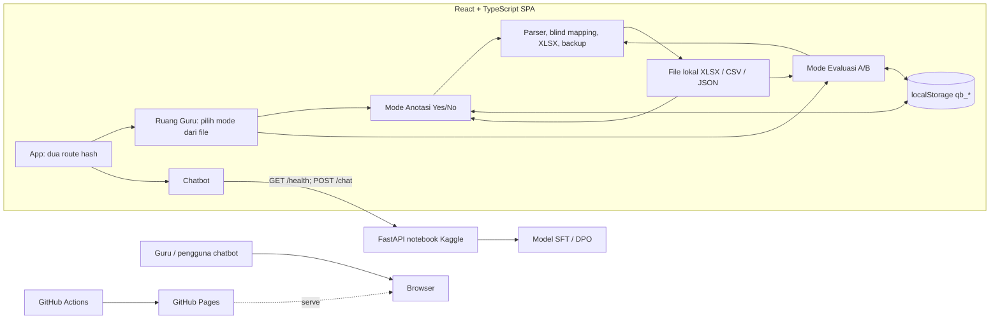

# Arsitektur

## Tujuan

Menjelaskan website yang mendukung dua mode penilaian berbasis file dan chatbot.

## Pola dan layer

1. **Presentation:** `App`, `GuruPage`, `AnotasiGuruPage`, `EvaluasiGuruPage`, `ChatbotPage`.
2. **Domain:** parser paket JSON dan Feedback/Rubrik/Skor, scoring anotasi, mapping blind A/B, validasi, backup, dan ekspor XLSX.
3. **Persistence:** `localStorage` terpisah per mode pada browser/origin.
4. **Integrasi lokal:** file XLSX/CSV/JSON dibaca di browser; tidak dikirim ke server. Chatbot memakai FastAPI notebook melalui API.
5. **Delivery:** Vite membangun static site untuk GitHub Pages.

## Batas

- Tahap persiapan data, training, agregasi, serta analisis penelitian dilakukan di notebook Kaggle.
- Semua penilaian tersimpan lokal; file backup/ekspor menjadi mekanisme pemindahan manual.
- Blind mapping dipakai hanya untuk mengevaluasi paket JSON; UI tidak menampilkan asal atau mapping model.
- Chatbot tetap merupakan integrasi jaringan terpisah dari alur penilaian.

## Sumber utama

| Area | File |
|---|---|
| Routing | `src/App.tsx` |
| Halaman | `src/pages/GuruPage.tsx`, `AnotasiGuruPage.tsx`, `EvaluasiGuruPage.tsx`, `ChatbotPage.tsx` |
| Parser/ekspor | `src/lib/feedback.ts`, `paket.ts`, `blind.ts`, `exportXlsx.ts` |
| Backup | `src/lib/backup.ts` |
| Backend chatbot | `dpo-guru.ipynb`, Langkah 22 |

## Dokumen Terkait

- [Tech stack](./TECH_STACK.md)
- [Struktur folder](./FOLDER_STRUCTURE.md)
- [Sitemap](./SITEMAP.md)
- [Integrasi](./INTEGRATIONS.md)

**Diperbarui:** 2026-10-27 · **Versi dokumen:** 1.3.0
