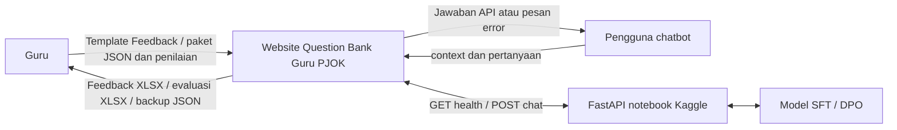
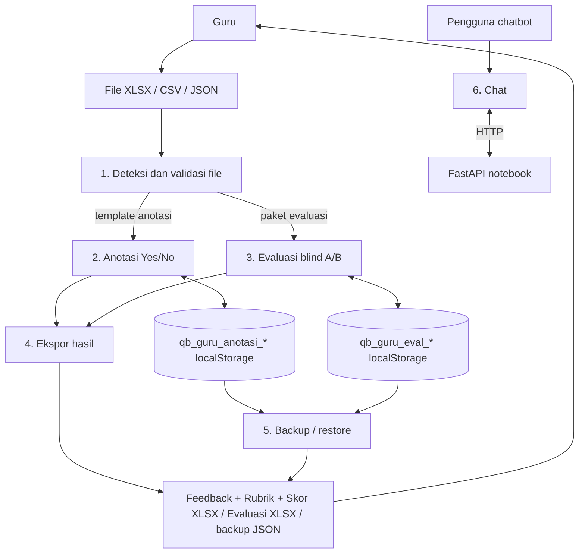

# Data Flow Diagram

## Tujuan

Menjelaskan perpindahan file dan state lokal pada dua bagian website.

## Level 0 — context

## Level 1 — proses dan data store

File tugas dibaca lokal. Proses anotasi/evaluasi dan backup tidak mengirim data ke API; hanya alur chatbot yang berkomunikasi dengan backend.
Rubrik dan skor anotasi disimpan bersama data lokal `qb_guru_anotasi_*` dan tercakup dalam backup.

## Dokumen Terkait

- [Arsitektur](./ARCHITECTURE.md)
- [ERD](./ERD.md)
- [API](./API.md)
- [Backup/recovery](./BACKUP_RECOVERY.md)

**Diperbarui:** 2026-10-27 · **Versi dokumen:** 1.3.0
