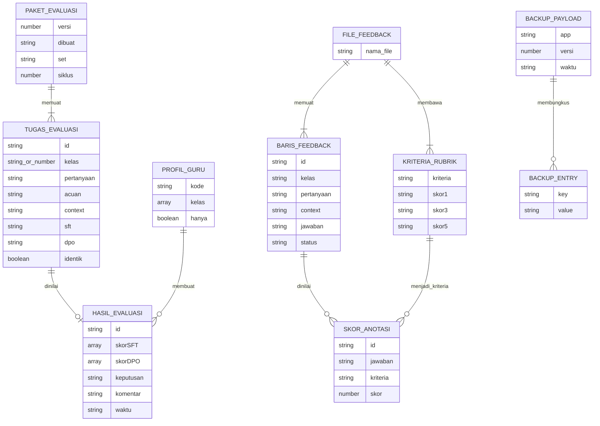

# ERD Konseptual

## Tujuan

Memvisualisasikan struktur file dan state browser. Diagram bukan skema database relasional.

`string_or_number` adalah union pada JSON, bukan tipe SQL. Relasi menunjukkan kumpulan data dalam file/localStorage; aplikasi tidak memiliki foreign key atau database relasional.

## Dokumen Terkait

- [Relasi](./RELATIONS.md)
- [Database schema](./DATABASE_SCHEMA.md)
- [Data dictionary](./DATA_DICTIONARY.md)

**Diperbarui:** 2026-10-27 · **Versi dokumen:** 1.2.0
