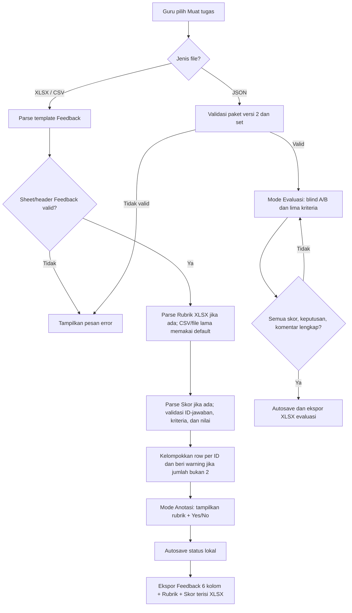
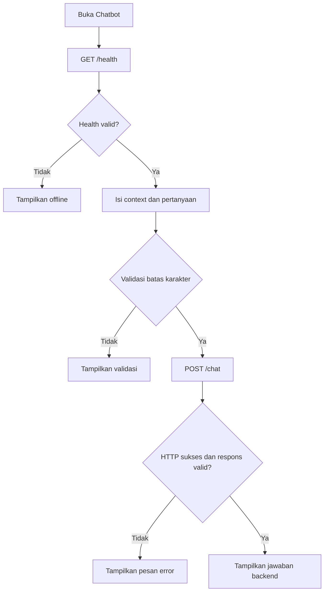
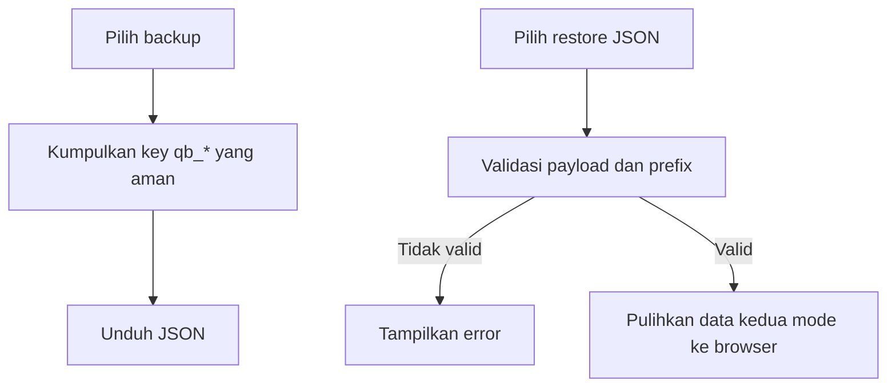

# Flowchart Proses

## Tujuan

Menggambarkan alur file Guru, chatbot, serta backup yang tersedia.

## Pemilihan mode dan anotasi

## Chatbot

## Backup/pemulihan

## Dokumen Terkait

- [User flow](./USER_FLOW.md)
- [Use cases](./USE_CASE.md)
- [Business rules](./BUSINESS_RULES.md)
- [State diagram](./STATE_DIAGRAM.md)

**Diperbarui:** 2026-10-27 · **Versi dokumen:** 1.3.0
