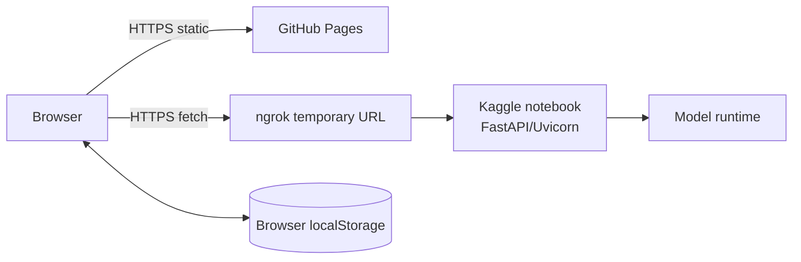

# Infrastructure

## Tujuan

Mencatat resource runtime tanpa mengasumsikan provisioning/IaC yang tidak ada.

## Komponen yang ditemukan

| Komponen | Runtime | Lifecycle |
|---|---|---|
| Frontend | Static assets `dist` di GitHub Pages. | Dibangun/deploy GitHub Actions pada branch default. |
| API | FastAPI/Uvicorn pada sesi notebook Kaggle. | Berjalan saat notebook deployment cell aktif. |
| Public tunnel | pyngrok/ngrok. | URL sementara berubah per sesi. |
| Model | Model SFT/DPO dimuat notebook untuk inference. | Resource Kaggle; status GPU dilaporkan `cuda` di health. |
| Persistence UI | localStorage browser. | Per origin/browser; bukan shared service. |

Tidak ditemukan Terraform, Bicep, CloudFormation, Docker/Kubernetes, managed database, server proxy, VPC design, atau infrastructure-as-code. Kapasitas, region, backup backend weights, dan availability SLA belum ditetapkan.

## Topology

## Dokumen Terkait

- [Architecture](./ARCHITECTURE.md)
- [Deployment](./DEPLOYMENT.md)
- [Monitoring](./MONITORING.md)
- [Risks](./RISKS.md)

**Diperbarui:** 2026-10-27 · **Versi dokumen:** 1.0.0
