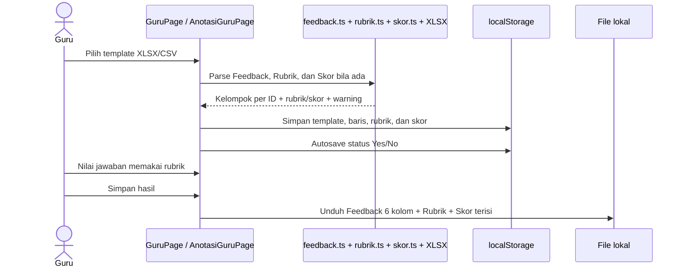
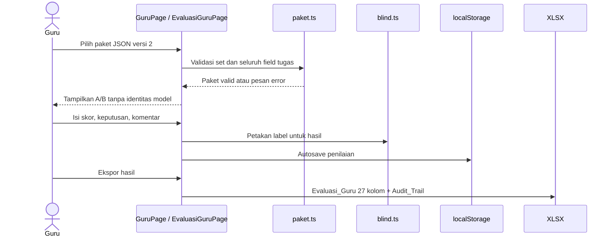
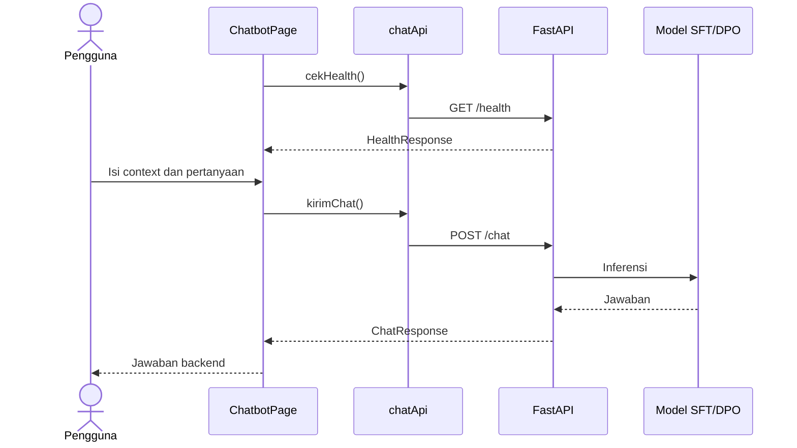
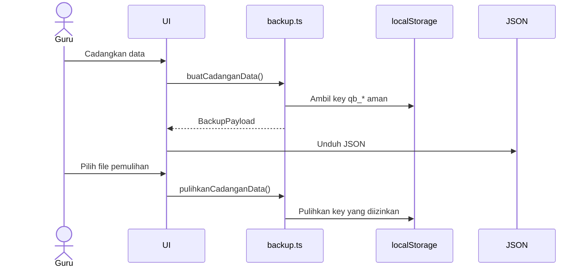

# Sequence Diagrams

## Tujuan

Memperlihatkan urutan interaksi untuk anotasi, evaluasi, chat, dan backup.

## UC-01: anotasi Feedback

## UC-02: evaluasi blind A/B

## UC-03: chatbot

## UC-04: backup/pulihkan

## Dokumen Terkait

- [Use cases](./USE_CASE.md)
- [API](./API.md)
- [Flowchart](./FLOWCHART.md)
- [Components](./COMPONENTS.md)

**Diperbarui:** 2026-10-27 · **Versi dokumen:** 1.3.0
