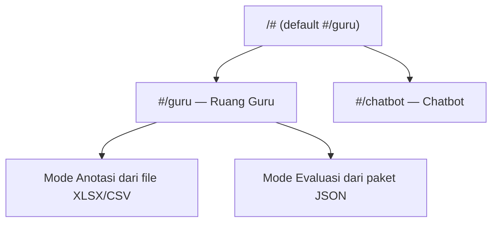

# Sitemap

## Tujuan

Mencatat rute yang tersedia pada website.

Hash yang tidak dikenal kembali ke Ruang Guru. Tidak ada halaman login atau peran terautentikasi.

## Dokumen Terkait

- [Arsitektur](./ARCHITECTURE.md)
- [User flow](./USER_FLOW.md)
- [Components](./COMPONENTS.md)

**Diperbarui:** 2026-10-27 · **Versi dokumen:** 1.1.0
