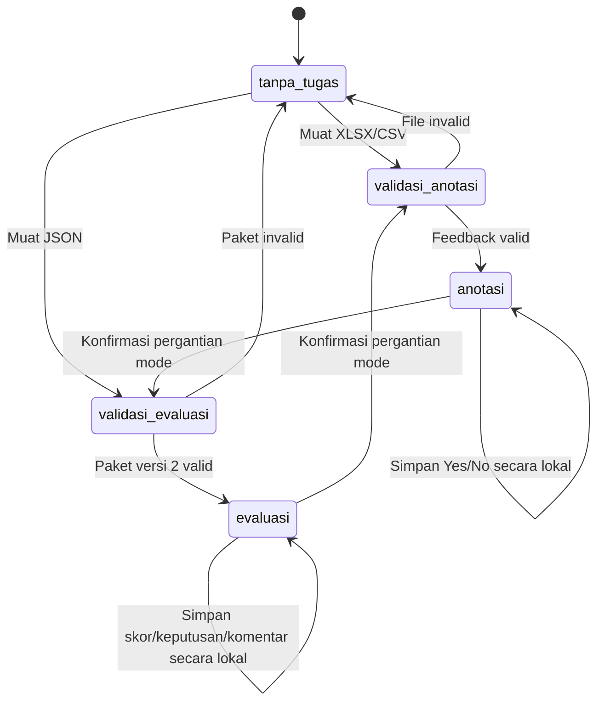
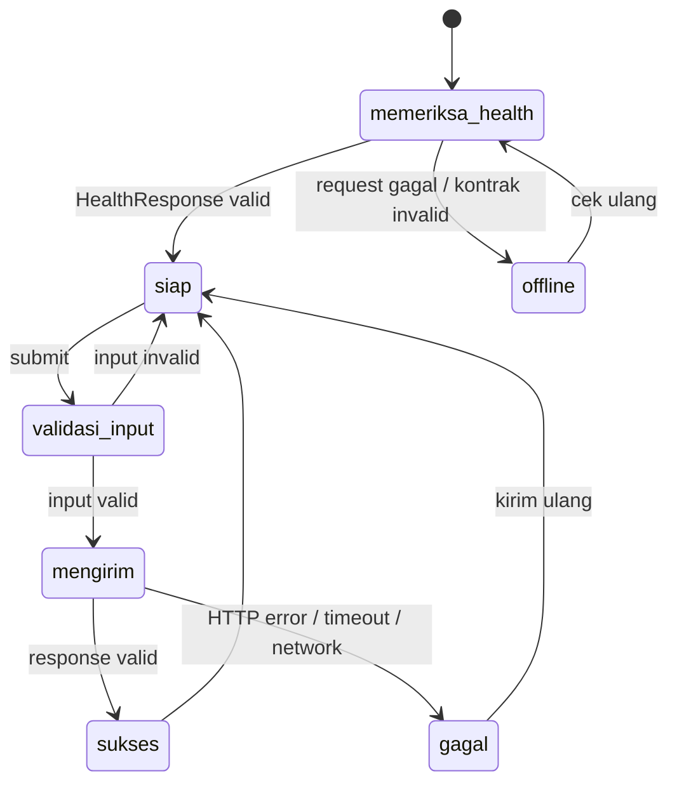

# State Diagram

## Tujuan

Menggambarkan pemilihan mode Guru dan siklus request chatbot.

## Mode Ruang Guru

Data anotasi dan evaluasi dipersistenkan dalam key terpisah; berpindah mode tidak otomatis menghapus data mode lainnya.

## Siklus request chatbot (transient)

## Dokumen Terkait

- [Data dictionary](./DATA_DICTIONARY.md)
- [Flowchart](./FLOWCHART.md)
- [API](./API.md)
- [Business rules](./BUSINESS_RULES.md)

**Diperbarui:** 2026-10-27 · **Versi dokumen:** 1.1.0
